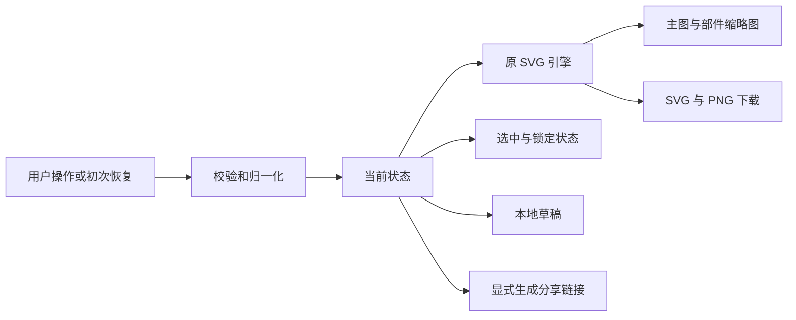

# 半身像工坊 · 开发与首发安排

日期：2026-11-26。所有者已批准本文全部开发安排，按六个切片推进。批准的是目标与执行顺序，不代表功能已经完成；明显手机布局草稿与正式发布仍须所有者验收。任务状态以 GitHub Issues / PR 为准。

## 已确认的目标与边界

- 产品是「轻量头像工坊」：面向普通用户，核心路径为生成 → 锁定喜欢的部分 → 微调 → 下载或分享。
- 托管使用 Cloudflare Workers Static Assets。应用没有后端，不部署到 Dokploy。
- Logo 使用第五轮「疏」，缩放 0.66。母版路径 `rounds/R05-2026-11-26/shu.svg` 保持不变。
- 绘图引擎、发型公式与实际 11 层顺序先不动。
- 源码许可尚未决定，不自行添加 LICENSE。导出形象的使用说明也尚未确认。

已批准的初版成功标准是：用户能完成一次生成、调整、下载和分享，锁定行为可信，手机编辑能看见结果，刷新能恢复草稿。当前功能与缺陷见 [完整评估](implementation-review-2026-11-26.md)，当前设计合同见 [DESIGN.md](DESIGN.md)。

## 已批准架构：保留单文件，明确职责

根目录 `index.html` 继续作为应用入口。当前规模无需为首发引入前端框架、数据库或服务端，也无需先拆成多文件。

| 边界 | 当前实现 | 已批准目标 |
| --- | --- | --- |
| 绘图 | Engine 根据状态输出自包含 SVG | 保留公式与图层顺序，以固定状态的 SVG 输出保护现有图形 |
| 状态 | UI 内维护 seed、slots、locks、params、colors、palette、view | 集中状态变更，让主图、缩略图、选中态和保存使用同一结果 |
| 恢复与分享 | URL 中的 `s` 参数，已有输入校验 | 加本地草稿与配置版本，明确优先级和旧链接行为 |
| 交互 | 控件、桌面预览、提示、下载 | 接入 Logo，修正说明、手机预览与键盘语义 |
| 发布 | 尚未配置 | 从显式清单生成 `dist/`，Workers 只发布此目录 |

已批准的目标状态流（草稿等尚未实现）：



这是职责图，不要求新增对应模块文件。拖动滑块时可合并绘制和保存，验收关注最终状态一致与交互流畅。

## 维护流程

参考既有项目维护方式，保留小 PR、短分支、明确合同、统一自检和发布证据。工具与门禁按本项目的实际规模设置。

1. **先有任务与验收。** 搜索已有 Issue，复用对应任务。新任务写清问题、范围、验收、依赖与回退方式；想法不直接进入实现。
2. **先明确行为再改代码。** 配置、分享格式、锁定语义和明显的手机布局变化，先写方案。已有批准决策直接执行；新增取舍才交给维护者判断。
3. **一分支、一目标、一 PR。** 使用 `docs/`、`fix/`、`feat/`、`chore/` 前缀；不直接 push main。认领和进度记录在 Issue，PR 关联 Issue。
4. **文档随行为变化。** 稳定设计写入 `docs/`；用户可见变化写 CHANGELOG；提交和 PR 使用中文，提交采用 Conventional Commits。
5. **自检统一入口。** 使用 `scripts/selftest.sh`，本地与最小 PR CI 调用相同的自动检查。涉及浏览器行为的 PR 另附手工验收证据，未检查的浏览器不写为通过。
6. **评审后合并，再核对上线。** 合并、构建成功和生产已更新分别核验。发布任务只有公开地址的核心流程通过后才完成；随后清理功能分支和 worktree。

切片 1 提供 [贡献指南](../CONTRIBUTING.md)、Issue / PR 模板、[selftest](../scripts/selftest.sh) 和最小 PR CI。自动检查保护当前引擎；浏览器行为修复和部署由后续切片交付。CI 是否在远端成功，以对应 PR 检查为准。

### 按切片落地的目标目录

```text
index.html                         应用源码入口，继续保留
assets/                            页面使用的 Logo 和图标派生资源
rounds/                            既有 Logo 设计历史，母版不移动
docs/
  commander-notes.md               已定决策与硬约束
  implementation-review-2026-11-26.md  本轮评估证据
  development-plan.md              本方案
  DESIGN.md                       随实现落地的行为与架构合同
  RELEASING.md                    首发时补齐实际发布和恢复步骤
scripts/                          自检与显式静态资源打包
tests/                            引擎、状态与分享的自动回归
.github/                          Issue / PR 模板和检查工作流
CONTRIBUTING.md                    贡献、分支、评审与门禁约定
CHANGELOG.md                       随已实现的用户可见变更维护
wrangler.jsonc                     Workers 静态资源配置
dist/                             生成产物，不提交，不作为源码维护
```

这是一份目标目录。按切片添加实际需要的文件，不一次创建空文档；有重大且长期有效的取舍时再补 ADR。开发工具可以有锁定的依赖，页面继续保持无外部运行时依赖。

## 开发切片与验收

以下工作划分已批准，不是另一份任务状态表，也没有为尚未创建的任务编造 Issue 编号。

| 顺序 | PR 范围 | 核心验收 |
| --- | --- | --- |
| 1 | 补维护入口、设计基线与最小自检，接续 Issue #5 的文档工作 | 记录当前 11 层与配置结构；固定状态渲染一致、渲染不修改输入、48 选项 × 3 裁切冒烟；PR CI 能执行自检 |
| 2 | Logo 接入与站点基础信息 | 页头使用既定母版的派生资源；32px 符号与活字字标；favicon 可辨识；母版哈希不变；桌面和手机无遮挡 |
| 3 | 锁定、随机与界面同步修复 | 全锁定后随机得到相同 SVG；部分锁定遵守明确合同；颜色、缩略图、预设选中态同步；重名标签修正；说明与实际行为一致 |
| 4 | 草稿恢复与分享合同 | 刷新恢复；合法分享优先；旧链接兼容；异常输入与存储不可用时仍可编辑；分享还原和导出使用同一状态 |
| 5 | 手机编辑体验与基础可访问性 | 调部件、颜色、参数时均可观察头像变化；无横向溢出；滑块有标签；按钮暴露选中/锁定状态；提示能被读屏感知 |
| 6 | 静态打包、Workers 配置与首发，接续 Issue #4 | 只上传应用资产；预览和公开地址核心流程通过；记录源提交、发布版本及恢复步骤 |

切片 1 由 Issue #5 承接。不要先重构引擎或铺新功能。切片 2 可在基线建立后独立交付；切片 4 依赖切片 3 的最终状态合同；切片 6 的正式发布依赖前面各项验收，并保留所有者正式发布验收节点。

### 切片 3：锁定契约需要写清

已批准规则：锁定的部件在重新生成时保留其外观所需的输入；锁定参数与颜色后，相应输入也不变化。全锁定时，随机按钮不得改变头像。用户主动解锁、换部件或调参数、颜色，仍可改变外观。

部件锁定不应暗示与其有关的所有参数、颜色都会自动锁定。若参数或颜色仍未锁定，随机生成可改变这些输入，并相应改变部件外观；界面说明要把这个关系说清。

当前全局 seed 同时影响随机选择和发型细节，是全锁定仍变形的原因。已批准在状态层区分随机抽签输入与传给引擎的绘图输入，保护锁定的发型细节。具体字段和种子输入框行为在该任务中明确，再编写回归。方案应保持原引擎公式和层序；若确需改变 Engine 接口，先说明影响。

### 切片 4：恢复与兼容目标

- 含合法分享参数时，按分享配置打开；没有分享参数时，恢复合法本地草稿；两者都没有时使用默认形象。
- 含非法分享参数时，保留目前的默认形象与错误提示行为，不静默改读另一份草稿。
- 首次打开分享链接不立即覆盖本地草稿；用户开始编辑后再保存，减少误覆盖。
- 本地存储损坏、空间不足或被禁用时，仍允许编辑、分享和下载；反馈保存失败，避免误报成功。
- 新配置携带格式版本；现有无版本链接按旧格式解析。旧状态渲染基线应保留，不因版本字段出现而改变已有头像。
- 未知的未来格式要明确提示，避免静默生成错误头像。暂不承诺任意未来引擎版本都能永久还原。

撤销/重做、JSON 导入、更多素材、云端图库、账号与批量 API 不进入首发。PWA 安装和离线缓存也不作为本次发布前提，先做好 Web 使用与浏览器图标。

## 首发方式与验收

首发计划版本为 `0.1.0`，尚未发布，不能把当前原型称为已发布版本。

发布分两步安排：先完成可评审的打包与部署配置，再用预览地址完成验收。生产首发须经所有者验收并保留明确的发布动作；不要在配置阶段接上未经约定的自动生产部署。

1. 生成 `dist/`，只复制 `index.html`、页面实际引用的资产与必要的站点配置。不得把仓库根目录整体当作发布目录。
2. 在 Wrangler 配置中指向 `dist/`，无需为纯静态页面增加服务端脚本。现有链接使用查询参数，不需要为分享增加路由系统。
3. 核对 Cloudflare 账号、目标 Worker 名称、仓库连接及构建命令。配置中不写凭据；命令与依赖版本待工具链落地时锁定。
4. 在预览地址检查生成、全锁定随机、手机微调、刷新恢复、中文/emoji 分享、SVG 和 PNG 下载、Logo 与图标。
5. 发布后在公开地址复测相同路径；确认实际生产版本对应预期提交。检查 `/docs/`、`/rounds/` 和配置文件路径不可取得原始内容。
6. 记录源提交、Worker 版本、地址、检查时间和已知限制。验证如何恢复上一可用版本；首次发布还应记录如何撤下故障版本。

浏览器建议至少覆盖 Chromium 桌面、手机尺寸及 Safari；微信内置浏览器列为单独兼容检查。没有对应环境时记录未验证，不把模拟尺寸当作真机验收。SVG 和 PNG 要实际打开，PNG 核对 1024×1024，不能只检查按钮被点击。

Cloudflare 的 Static Assets 与 Git 构建能力已核对官方资料，日期为 2026-11-26。当前尚未检查账号、认证、域名或部署资源；本方案没有承诺已经拥有可用线上地址。

参考资料：

- [Workers Static Assets](https://developers.cloudflare.com/workers/static-assets/)
- [Workers Builds](https://developers.cloudflare.com/workers/ci-cd/builds/)

## 已有 Issue 如何接续

- [#5：建立单页项目的维护与回归基线](https://github.com/ConteMan/avatar-studio/issues/5)：Logo 等待条件已经解除，现承接工程与文档基线；Logo 页面接入另开独立任务。
- [#4：Workers 发布任务](https://github.com/ConteMan/avatar-studio/issues/4)：托管选择已经完成，发布仍未完成，继续跟踪部署与线上验收，不能因选型完成就关闭。

基线阶段交付维护与自检，不更改应用功能或部署。按 Issue / PR 中的证据验收各切片，不用本文维护实时完成状态。
